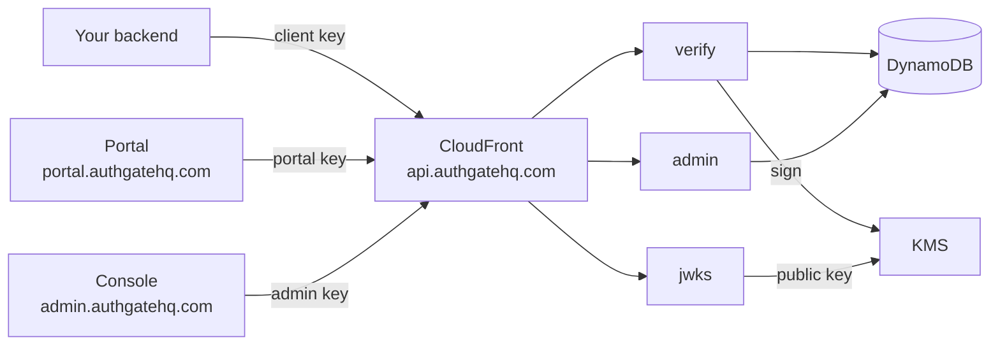

# AuthGate

AuthGate adds a second factor, a PIN or a passkey, to any backend. Your backend asks it to
enroll a factor for one of your users, and later to verify it. A verification answers with a
short-lived ES256 token signed by AWS KMS, which your backend checks offline. Browsers never call
AuthGate; only backends do, each with its own client key.

It runs on AWS Lambda behind CloudFront and is live on `authgatehq.com`:

| | |
| --- | --- |
| API | `https://api.authgatehq.com` |
| Portal: sign up and manage your own clients | [portal.authgatehq.com](https://portal.authgatehq.com) |
| Docs, and a demo app that uses AuthGate (EN/VI) | [d3d49hg6rb8ylx.cloudfront.net](https://d3d49hg6rb8ylx.cloudfront.net) |
| Console, for the operator | `https://admin.authgatehq.com` |

## A step-up, end to end

Your backend already knows its user (the *subject*). Before a sensitive action it opens a
challenge, your page collects the PIN or runs the passkey ceremony, and your backend relays the
answer:

```mermaid
sequenceDiagram
    participant B as Browser
    participant C as Your backend
    participant A as AuthGate
    B->>C: change my email
    C->>A: POST /api/challenges (client key; subjectId, purpose, factor)
    A-->>C: challenge id, plus WebAuthn options for a passkey
    C-->>B: ask for the PIN or the passkey
    B->>C: PIN, or the signed assertion
    C->>A: POST /api/challenges/{id}/verify
    A-->>C: token (ES256 JWT, 5 minutes by default)
    C->>C: check signature (JWKS), aud, exp and purpose, then change the email
```

A token carries the action it was issued for (`purpose`), so a token for `transfer` cannot
authorise `change-email`. How to check one:
[how a consumer verifies a token](docs/reference/api.md#how-a-consumer-verifies-a-token). Every
route: [the API reference](docs/reference/api.md).

## Three apps, three stacks



- AuthGate is one Go binary deployed as three Lambda functions behind one CloudFront distribution
  that routes by path. Only `verify` can sign, only `admin` edits clients, and `jwks` holds no
  secret at all.
- The [Portal](docs/reference/portal.md) is where anyone signs up, verifies an email address,
  enrols a mandatory second factor and manages their own clients.
- The [Console](docs/reference/console.md) is the operator's app: every client, its keys, disable
  and enable, one user's factors, and the audit log. Its admins sign in with a password plus a
  factor that AuthGate itself verifies.

The Console and the Portal are separate stacks with their own tables, and each reaches AuthGate
over HTTP like any other client. Both web apps are React, Vite and Mantine, in English and
Vietnamese.

## Decisions worth reading

Each is a one-page memo with the reasons and the alternatives that lost:

- [Three roles, one binary](docs/memo/three-roles-one-binary.md), behind
  [one CloudFront door](docs/memo/one-door-cloudfront.md). The functions refuse calls that skip
  the door.
- [KMS signs the tokens](docs/memo/kms-signs-not-ssm.md). The private key never leaves KMS, and
  consumers verify against the JWKS.
- [A client key is a hash lookup](docs/memo/client-key-is-a-hash-lookup.md). Only its SHA-256 is
  stored, and the client id comes from the key, never from the request.
- [A PIN goes through a challenge](docs/memo/pin-goes-through-a-challenge.md), as a passkey does,
  and [every challenge belongs to one client](docs/memo/challenge-is-client-scoped.md).
- [WebAuthn without a browser path](docs/memo/webauthn-without-a-browser.md). The browser talks
  only to your backend, which relays the ceremony.
- [The rate limit is a token bucket in the table](docs/memo/rate-limit-bucket.md), per client,
  shared by every Lambda instance.
- [Client ownership and the portal key](docs/memo/client-ownership.md). A tenant reaches only its
  own clients, and the admin and portal keys never open each other's routes.
- [Console sessions](docs/memo/console-sessions.md) and
  [Portal accounts](docs/memo/portal-accounts.md): no account enumeration, a mandatory second
  factor, and a step-up before each sensitive action.
- [The custom domain](docs/memo/custom-domain.md): one certificate, DNS only, one rpId per app.
- [No health endpoint](docs/memo/no-health-endpoint.md).

The full designs are in [`docs/superpowers/specs/`](docs/superpowers/specs/).

## Security and operations

- Every merge to `main` deploys from GitHub Actions through an OIDC role, so CI holds no
  long-lived AWS key. A permissions boundary caps every role the deployer can create.
  [Deploy and CI](docs/reference/deploy.md).
- Secrets live in SSM and reach scripts through 0600 files, never a command line or a log.
- AuthGate rate-limits each client with a token bucket. The Console limits each IP and locks
  accounts after failed sign-ins; the Portal limits each IP, account and address, and puts
  Cloudflare Turnstile on every sign-up and email route.
- Email goes out through SES from `no-reply@authgatehq.com`, signed with DKIM and covered by DMARC.
  Replies reach `support@`. [Custom domain and mail](docs/reference/custom-domain.md).
- Every DNS record is DNS only, so the per-IP limits and the audit log see the viewer's real IP.

## Run it locally

You need Go (the version in `go.mod`), Docker, Node.js 22 or newer, pnpm 10.13.1, `jq` and `git`.

```bash
pnpm install
pnpm run check   # lint, shell tests, then go vet, golangci-lint and the Go tests
make dev         # DynamoDB Local on :8000 and the three roles on :8080
```

`make console-dev` and `make portal-dev` run the other two apps.
[Development](docs/reference/development.md) covers the Bruno collections and the worktree
tooling.

## Documentation

| | |
| --- | --- |
| Reference | [API](docs/reference/api.md) · [Console](docs/reference/console.md) · [Portal](docs/reference/portal.md) · [Deploy and CI](docs/reference/deploy.md) · [Custom domain and mail](docs/reference/custom-domain.md) · [Development](docs/reference/development.md) |
| Runbooks, step by step against a live stage | [Tenant-aware AuthGate (P1)](docs/runbooks/rollout-p1.md) · [The Portal (P2)](docs/runbooks/rollout-p2.md) · [The custom domain](docs/runbooks/rollout-custom-domain.md) |
| Decisions | [`docs/memo/`](docs/memo/), one per file |
| Designs and plans | [`docs/superpowers/`](docs/superpowers/) |
| Worktree tooling | [`docs/infra/`](docs/infra/00-overview.md) |

## Repository layout

```text
cmd/auth-gate/        ROLE selects the mux; Lambda adapter and local dev server
cmd/backfill-clients/ one-off: write the list-index item for existing clients
cmd/console/          Console Lambda; `console admin ...` operator commands
cmd/portal/           Portal Lambda and its local dev server
cmd/smoke/            WebAuthn round trip against a deployed stage
internal/platform/   foundation: dynamo, kms, ssm, httpx, config, log, ratelimit, and the parts the
                     Console and Portal share (websession, lockout, lease, firstfactor, auditlog,
                     password, webapi, viewerip)
internal/auth/       domain: client, pin, webauthn, challenge, token, handlers
internal/console/    Console: accounts, sessions, step-up, audit, handlers, authgate client
internal/portal/     Portal: accounts, sessions, workspaces, clients, mail, avatars, turnstile, hibp
console-web/  portal-web/   the web apps: React, Vite, Mantine, EN/VI strings
packages/web-kit/   shared web code (theme, UI parts, API client, i18n, WebAuthn) for the Console and the Portal
infra/template.yaml  SAM: three functions, table, KMS key, CloudFront door
infra/console.yaml   SAM: the Console stack
infra/portal.yaml    SAM: the Portal stack
infra/*.json         deployer policy and the permissions boundary
scripts/setup-and-deploy/  the manual deploy and smoke steps
scripts/console/     the Console's deploy, register, admin, smoke and purge steps
scripts/portal/      the Portal's deploy, register, smoke and purge steps
scripts/domain/      the SES identity and the DNS records the custom domain needs
bruno/  bruno-console/  bruno-portal/  integration collections (AuthGate; the Console API; the Portal API)
docs/reference/      how each part works and is deployed
docs/runbooks/       rollouts against a live stage, step by step
docs/memo/           one decision per file
docs/infra/          the worktree tooling
docs/adr/  docs/superpowers/   ADRs for the tooling; specs and plans
tools/wt/  .claude/  worktree scripts; Claude Code hooks and commands
```

`internal/platform` never imports `internal/auth`.

## License

MIT. See [LICENSE](LICENSE).
