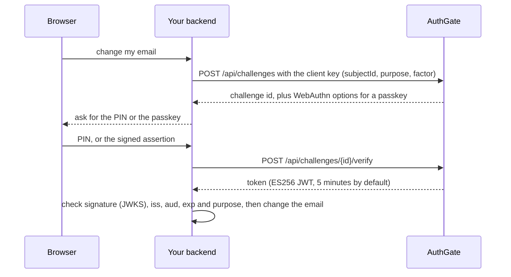
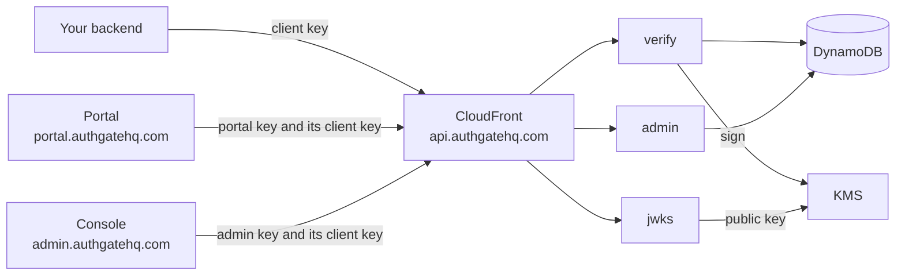

# AuthGate

AuthGate adds a second factor, a PIN or a passkey, to any backend: a step-up before a sensitive
action, the second step of a login, or a passkey-only login. Your backend asks it to enroll a
factor for one of your users, and later to verify it. A verification answers with a short-lived
ES256 token signed by AWS KMS, which your backend checks locally against the published keys.
Browsers never call AuthGate; only backends do, each with its own client key.

It runs on AWS Lambda behind CloudFront:

| What | Where |
| --- | --- |
| The API | `https://api.authgatehq.com` |
| Portal: sign up and manage your own clients | [portal.authgatehq.com](https://portal.authgatehq.com) |
| Docs, and a demo app that uses AuthGate (EN/VI) | [authgatehq.com](https://authgatehq.com) |
| Console: the operator's app, no sign-up | `https://admin.authgatehq.com` |

To integrate, sign up on the Portal, create a client, and follow the docs.

## A step-up, end to end

Your backend already knows its user (the *subject*). Before a sensitive action it opens a
challenge, your page collects the PIN or runs the passkey ceremony, and your backend relays the
answer:



A token names the action it was issued for (`purpose`), so your backend can refuse a token issued
for `transfer` when the action is `change-email`. The [API reference](docs/reference/api.md)
lists every route and [how to check a token](docs/reference/api.md#how-a-consumer-verifies-a-token).

## The three apps



- AuthGate is one Go binary deployed as three Lambda functions behind one CloudFront distribution
  that routes by path. Only `verify` can sign, only `admin` serves the client-management routes,
  and `jwks` holds no secret.
- The [Portal](docs/reference/portal.md) is where developers sign up, verify an email address,
  enroll a mandatory second factor and manage their own clients, alone or in an organisation they
  invite others to ([organisations](docs/memo/portal-organisations.md)).
- The [Console](docs/reference/console.md) is the operator's app: every client, its keys, disable
  and enable, purging one user's factors, and the audit log. Its admins sign in with a password
  plus a factor that AuthGate itself verifies.

The Console and the Portal are separate stacks with their own tables. Each reaches AuthGate over
HTTP with its own client key, like any other client, to check its users' factors. Both web apps
are React, Vite and Mantine, in English and Vietnamese.

## Security and operations

- Every merge to `main` deploys from GitHub Actions through an OIDC role, so CI holds no
  long-lived AWS key, and a permissions boundary caps every role the deployer can create
  ([deploy and CI](docs/reference/deploy.md)).
- Secrets move between scripts and SSM through 0600 files, never on a command line or in a log.
- A client that spends its rate-limit bucket gets `429` with `Retry-After`. The Console and the
  Portal limit each IP and lock an account after failed sign-ins. The Portal also limits each
  address, and asks for Cloudflare Turnstile on sign-up, on resending the verification link, on
  the password and factor reset requests, and on sign-in after two failures.
- Email goes out through SES from `no-reply@authgatehq.com`, signed with DKIM and covered by DMARC,
  and replies reach `support@` ([custom domain and mail](docs/reference/custom-domain.md)).
- Every DNS record is DNS only, so the per-IP limits and the audit log see the viewer's real IP.

## Design decisions

Each is a one-page memo with the reasons and the alternatives that lost:

- [Three roles, one binary](docs/memo/three-roles-one-binary.md), behind
  [one CloudFront door](docs/memo/one-door-cloudfront.md): `verify` and `admin` refuse calls that
  skip the door, and only the public JWKS answers anyone.
- [KMS signs the tokens](docs/memo/kms-signs-not-ssm.md): the private key never leaves KMS.
- [A client key is a hash lookup](docs/memo/client-key-is-a-hash-lookup.md): only its SHA-256 is
  stored, and the client id comes from the key, never from the request.
- [A PIN goes through a challenge](docs/memo/pin-goes-through-a-challenge.md), as a passkey does,
  and [every challenge belongs to one client](docs/memo/challenge-is-client-scoped.md).
- [WebAuthn without a browser path](docs/memo/webauthn-without-a-browser.md): your backend relays
  the options and the assertion, and AuthGate checks the origin and the rpId each client
  registered.
- [The rate limit is a token bucket in the table](docs/memo/rate-limit-bucket.md), so every Lambda
  instance shares one bucket per client.
- [Client ownership and the portal key](docs/memo/client-ownership.md): a tenant reaches only its
  own clients, and the admin and portal keys never open each other's routes.
- [Console sessions](docs/memo/console-sessions.md) and
  [Portal accounts](docs/memo/portal-accounts.md): no account enumeration, a mandatory second
  factor, and a step-up before each sensitive action.
- [The custom domain](docs/memo/custom-domain.md): one certificate, DNS only, one rpId per app.
- [No health endpoint](docs/memo/no-health-endpoint.md): no role answers `/health` or `/version`,
  and an unknown path is a 404.

## Run it locally

You need Go (the version in `go.mod`), golangci-lint v2 on your `PATH`, Docker, Node.js 22 or
newer, pnpm 10.13.1, `jq` and `git`.

```bash
pnpm install
pnpm run check   # lint, typecheck, tests and build, then make check (go vet, golangci-lint, go test)
make dev         # DynamoDB Local on :8000 and the three roles on :8080
```

To run the Console or the Portal as well, follow their own "Run it locally" sections
([Console](docs/reference/console.md#run-it-locally), [Portal](docs/reference/portal.md#run-it-locally)).
[Development](docs/reference/development.md) covers the Bruno collections and the worktree
tooling.

## Documentation

| Kind | Where |
| --- | --- |
| Reference | [API](docs/reference/api.md) · [Console](docs/reference/console.md) · [Portal](docs/reference/portal.md) · [Deploy and CI](docs/reference/deploy.md) · [Custom domain and mail](docs/reference/custom-domain.md) · [Development](docs/reference/development.md) |
| Rollouts already run on stg, kept as a record | [Tenant-aware AuthGate (P1)](docs/runbooks/rollout-p1.md) · [The Portal (P2)](docs/runbooks/rollout-p2.md) · [The custom domain](docs/runbooks/rollout-custom-domain.md) |
| Decisions | [`docs/memo/`](docs/memo/), one per file |
| Designs and plans | [`docs/superpowers/`](docs/superpowers/) |
| Worktree tooling | [`docs/infra/`](docs/infra/00-overview.md) |

## Repository layout

```text
cmd/auth-gate/        ROLE selects the mux; Lambda adapter and local dev server
cmd/backfill-clients/ one-off: write the list-index item for existing clients
cmd/console/          Console Lambda; `console admin ...` operator commands
cmd/portal/           Portal Lambda and its local dev server
cmd/prune-factors/    delete the PINs and passkeys of soft-deleted clients
cmd/smoke/            WebAuthn round trip against a deployed stage
internal/platform/   foundation: dynamo, kmsx, ssmx, httpx, config, id, ratelimit; authgate, the
                     HTTP client the Console and the Portal use; and the parts they share
                     (websession, lockout, lease, firstfactor, auditlog, password, webapi, viewerip)
internal/auth/       domain: client, pin, webauthn, factor, challenge, token, service, handler
internal/console/    Console: accounts, sessions, step-up, audit, handlers
internal/portal/     Portal: accounts, sessions, workspaces, clients, mail, avatars, turnstile, hibp
console-web/  portal-web/   the web apps: React, Vite, Mantine, EN/VI strings
packages/web-kit/   shared web code (theme, UI parts, API client, i18n, WebAuthn) for the Console and the Portal
infra/template.yaml  SAM: three functions, table, KMS key, CloudFront door
infra/console.yaml   SAM: the Console stack
infra/portal.yaml    SAM: the Portal stack
infra/*.json         deployer policy and the permissions boundary
scripts/setup-and-deploy/  the manual deploy and smoke steps
scripts/console/     the Console's deploy, register, admin, smoke and purge steps
scripts/portal/      the Portal's deploy, register, smoke and purge steps
scripts/domain/      the SES identity and the DNS records the custom domain needs
bruno/  bruno-console/  bruno-portal/  integration collections (AuthGate; the Console API; the Portal API)
docs/reference/      how each part works and is deployed
docs/runbooks/       the rollouts run on stg, step by step
docs/memo/           one decision per file
docs/infra/          the worktree tooling
docs/adr/  docs/superpowers/   ADRs for the tooling; specs and plans
tools/wt/  .claude/  worktree scripts; Claude Code hooks and commands
```

The Console and the Portal reach AuthGate over HTTP only: `make check` fails if either depends on
`internal/auth/service`, or if the Portal imports `internal/console`.

## License

MIT. See [LICENSE](LICENSE).
